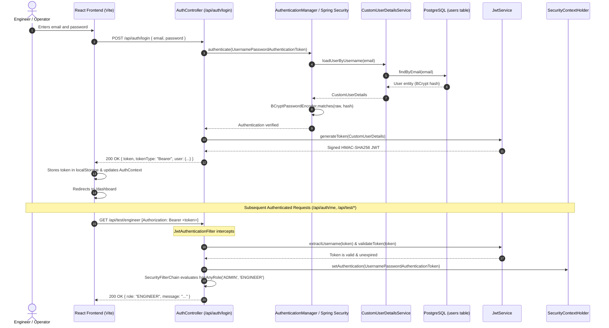

# Authentication & Authorization Architecture — FedMaintain

Phase 2 establishes the cryptographic and access control foundation of FedMaintain using Spring Security, stateless JSON Web Tokens (JWT), BCrypt password hashing, and Role-Based Access Control (RBAC).

---

## 1. Authentication Lifecycle

---

## 2. Role Matrix & Permissions

FedMaintain defines three distinct operational roles in `com.fedmaintain.user.entity.Role`:

| Role | Operational Scope | Endpoints Authorized | Sidebar Modules |
| :--- | :--- | :--- | :--- |
| **`ADMIN`** | Platform owner, system configuration, user auditing | Full access: `/api/test/admin`, `/api/test/engineer`, `/api/test/operator`, `/api/auth/*` | Dashboard, Plants, Machines, Sensors, Predictions, Digital Twin, Federated Learning, Maintenance, Analytics, User Management, Settings |
| **`ENGINEER`** | Fab process engineer, equipment specialist, maintenance planner | Operational & Engineering access: `/api/test/engineer`, `/api/test/operator` (Denied `/api/test/admin`) | Dashboard, Plants, Machines, Sensors, Predictions, Digital Twin, Federated Learning, Maintenance, Analytics |
| **`OPERATOR`** | Cleanroom bay operator, tool monitor | Monitoring & task operational access: `/api/test/operator` (Denied `/api/test/admin` and `/api/test/engineer`) | Dashboard, Machines, Sensors, Predictions, Digital Twin, Maintenance |

---

## 3. JWT Security Specifications

- **Algorithm**: HMAC-SHA256 (`HS256`).
- **Signature Key**: 256-bit cryptographic secret loaded strictly from `JWT_SECRET` environment variable.
- **Expiration**: Configurable via `JWT_EXPIRATION` (defaults to 24 hours / `86400000ms`).
- **Standard Claims**:
  - `sub`: User email address.
  - `iat`: Issue timestamp.
  - `exp`: Expiration timestamp.
- **Custom Claims**:
  - `id`: Unique user database ID.
  - `name`: User full display name.
  - `role`: Role string (`ADMIN`, `ENGINEER`, `OPERATOR`).

---

## 4. Initial Admin Account Bootstrap

On application startup, `DataInitializer` implements `CommandLineRunner` and evaluates:
- If `userRepository.existsByEmail(adminEmail)` is `false`, it creates the initial `ADMIN` user utilizing:
  - `ADMIN_EMAIL`: `${ADMIN_EMAIL:admin@fedmaintain.com}`
  - `ADMIN_PASSWORD`: `${ADMIN_PASSWORD:Admin@123}`
  - `ADMIN_NAME`: `${ADMIN_NAME:FedMaintain Admin}`
- Passwords are never committed in plaintext or logged.
