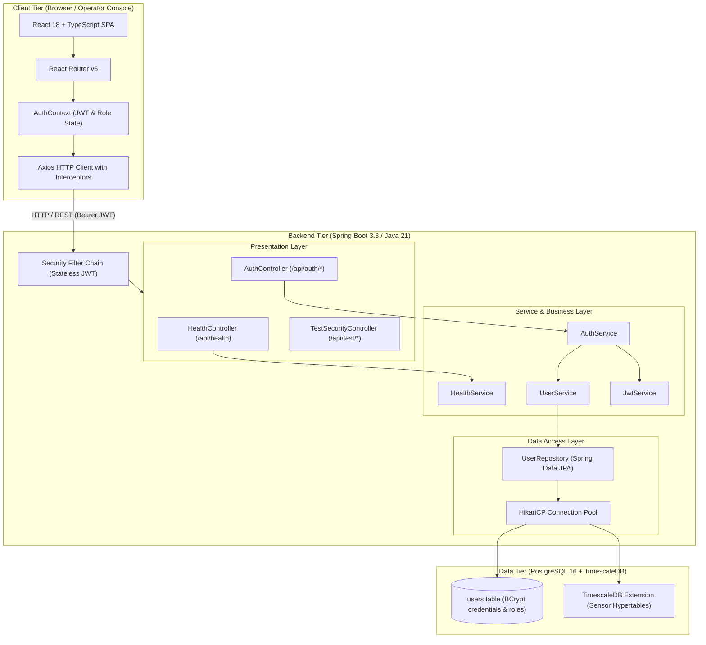

# System Architecture — FedMaintain

FedMaintain is an enterprise-grade, distributed predictive maintenance and digital twin platform specifically engineered for semiconductor fabrication equipment (lithography scanners, plasma etchers, CMP polishers, ion implanters, and vacuum chemical vapor deposition tools).

---

## 1. High-Level Modular Monolith Architecture

FedMaintain is designed as a **clean modular monolith** to prioritize development velocity, maintainability, type safety, and operational simplicity during early phases, while providing strict domain isolation for future extraction into distributed edge nodes.

---

## 2. Layering & Architectural Principles

FedMaintain strictly enforces clean code and layered architectural boundaries:

1. **Controller Layer (`com.fedmaintain.controller`, `com.fedmaintain.auth.controller`)**:
   - Accepts HTTP requests and delegates immediately to service interfaces.
   - Performs input validation (`@Valid`).
   - Contains **zero business logic**.
   - Employs **constructor dependency injection** exclusively (no field injection via `@Autowired`).

2. **Service Layer (`com.fedmaintain.service`, `com.fedmaintain.user.service`, `com.fedmaintain.auth.service`)**:
   - Houses transactional business logic and security assertions.
   - Orchestrates domain events, cryptographic hashing, and entity conversions.

3. **Repository Layer (`com.fedmaintain.user.repository`)**:
   - Built on Spring Data JPA, executing type-safe queries against PostgreSQL.

4. **Security & Cryptography (`com.fedmaintain.security`)**:
   - Stateless JWT authentication filter (`OncePerRequestFilter`).
   - Strong BCrypt password encoding (10 rounds).
   - Method-level and path-level Role-Based Access Control (`ADMIN`, `ENGINEER`, `OPERATOR`).

5. **Common & Exception Handling (`com.fedmaintain.common`, `com.fedmaintain.exception`)**:
   - Reusable `ApiResponse<T>` and `ErrorResponse` envelopes.
   - Centralized `@RestControllerAdvice` preventing stack trace leakage to clients.
